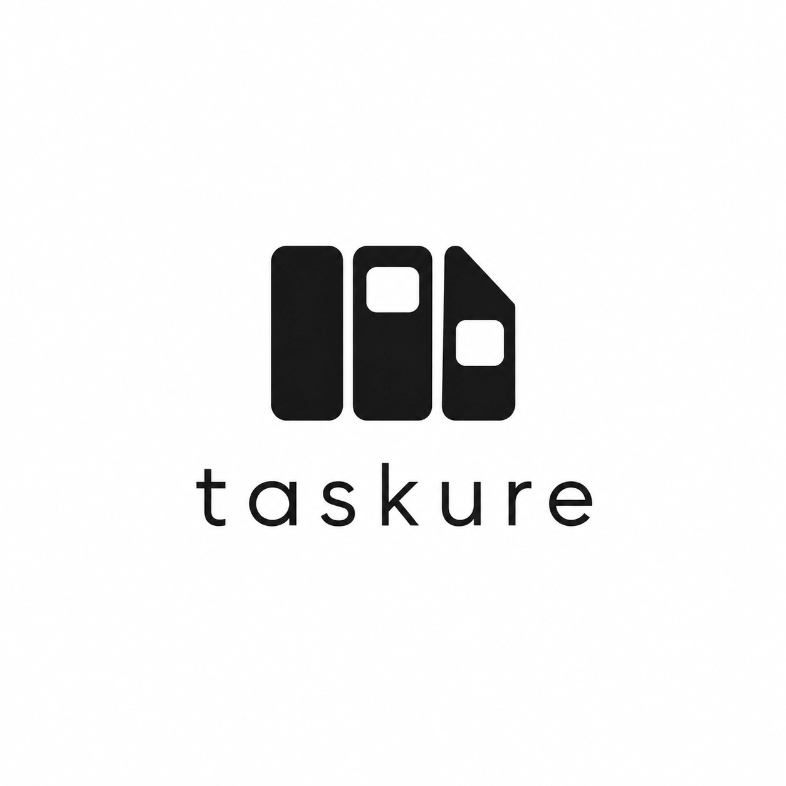

<div align="center">
  
</div>

<div align="center">
  <a href="https://go.dev"></a>
  <a href="https://www.typescriptlang.org"></a>
  <a href="https://nextjs.org"></a>
  <a href="https://podman.io"></a>
  <a href="https://www.docker.com"></a>
  <a href="https://github.com/Ijon6k/Taskure/pkgs/container/taskure%2Fbackend"></a>
  <a href="LICENSE"></a>
</div>

<div align="center">
  <b>Taskure</b> — modern, self-hosted personal workspace for Kanban, notes, and AI-assisted workflows.
</div>

---

## Deployment & Getting Started

### Option 1: Standalone Compose Deployment (Recommended)

You do **not** need to clone the entire repository to run Taskure:

```bash
# 1. Create a dedicated taskure folder on your machine
mkdir -p ~/taskure && cd ~/taskure

# 2. Download the compose file and environment example
curl -fsSL https://raw.githubusercontent.com/Ijon6k/Taskure/dev/compose.yaml -o compose.yaml
curl -fsSL https://raw.githubusercontent.com/Ijon6k/Taskure/dev/.env.example -o .env.example

# 3. Copy the example environment file to .env
cp .env.example .env

# 4. Start the stack (Docker or Podman)
docker compose up -d
# or using Podman:
podman compose up -d

# → Access Taskure in your browser at: http://localhost:1106
```

#### Container Image Tags (`IMAGE_TAG` in `.env`)
You can configure which image version to run by editing `IMAGE_TAG` in your `.env` file before running compose:
* **`IMAGE_TAG=latest`** *(Default & Recommended)*: Tracks the latest official stable release.
* **`IMAGE_TAG=dev`**: Bleeding-edge build directly from the active `dev` branch.
* **`IMAGE_TAG=sha-<commit>`**: Pinned commit build (e.g. `sha-8a4e321`) for strictly reproducible deployments.

---

### Option 2: Clone & Build from Source (For Developers)

```bash
# 1. Clone the repository
git clone https://github.com/Ijon6k/Taskure.git
cd Taskure

# 2. Prepare environment file
cp .env.example .env

# 3. Build and launch all services locally
docker compose -f compose.dev.yaml --profile full up -d --build
# or using Podman:
podman compose -f compose.dev.yaml --profile full up -d --build

# → Access Taskure in your browser at: http://localhost:1106
```

---

## Screenshots

| | | |
|:---:|:---:|:---:|
|  |  |  |
| *Kanban board* | *Notebook editor* | *Task drawer* |
|  |  | |
| *Project dashboard* | *Settings & themes* | |

---

## Features

| Feature | Description |
| :--- | :--- |
| **Kanban Board** | Drag & drop columns, tasks, multi-facet filtering, inline editing |
| **Task Drawer** | Priority levels, tags, due date reminders, checklist sub-items |
| **Notebook Editor** | TipTap rich markdown editor with syntax highlighting, tables, slash `/` menu |
| **AI Assistant & Streaming Chat** | Autonomous agent, RAG pipeline with pgvector, HITL plan approval |
| **Asset Storage** | Ultra-lightweight self-hosted **SeaweedFS** S3 (~30MB RAM footprint) |
| **Smart Dynamic Resizing** | Native Go WebP thumbnail and image-variant generation engine |
| **Templates & Backup** | Project creation templates with full JSON export / import |
| **Theming Engine** | Dark (OLED), Dim (Graphite), Light (Paper) with 5 vibrant accent colors |
| **Zero Port Exposure** | Strictly isolated behind Gateway reverse proxy on port 1106 |

---

## Services & Architecture

In production, **only port 1106 is exposed to the host machine**. All internal services communicate strictly over the internal container network (`kanban-network`).

**Service Stack**

| Service | Technology | Internal Port | Host Port | Description |
|:---|:---|:---:|:---:|:---|
| **Gateway** | Nginx 1.26 Alpine | `80` | `1106` | API Gateway & reverse proxy |
| **Web** | Next.js 16 · Bun · React 19 · Tailwind | `3000` | — | Frontend web application |
| **API** | Go 1.25 · Gin · GORM | `4000` | — | REST API, tool engine & dynamic images |
| **AI** | Python 3.12 · FastAPI · pgvector | `5000` | — | RAG pipeline, agent orchestrator & workers |
| **PostgreSQL** | Postgres 16 + pgvector | `5432` | — | Relational & vector database |
| **SeaweedFS** | SeaweedFS (Go) | `9000` | — | Lightweight S3-compatible object storage |

**Request Flow**

```text
Browser → Gateway (:1106)
           ├── /          → Next.js Frontend (:3000)
           ├── /api/*     → Go REST API (:4000) ──→ PostgreSQL + pgvector
           ├── /ai/*      → FastAPI AI (:5000)   ──→ PostgreSQL + pgvector
           └── /storage/* → Go Media Proxy      ──→ SeaweedFS S3 (:9000)
```

---

## Local Development (Without Containers)

If you wish to run backend and frontend directly on your host machine:

```bash
# Start backing stores
docker compose -f compose.dev.yaml up -d postgres seaweedfs

# Run Go backend
cd backend && go run ./cmd/server

# Run Next.js frontend
cd frontend && bun install && bun dev
```

---

## License

MIT · [Ijon6k](https://github.com/Ijon6k)
